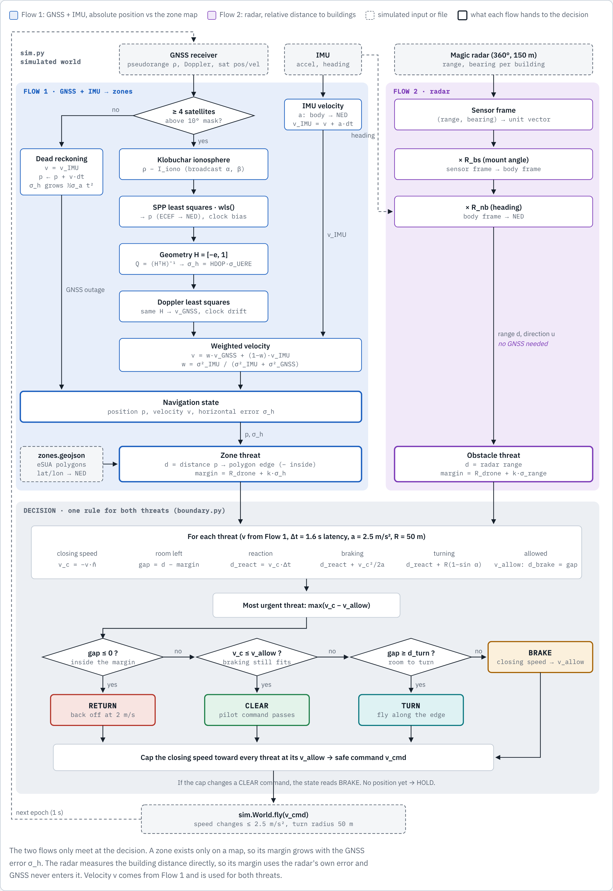
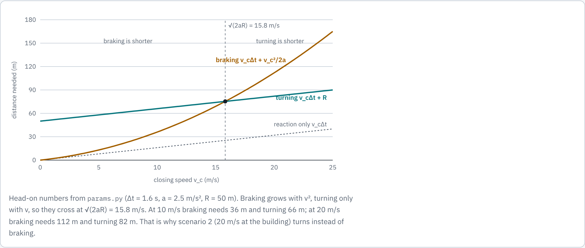

# LAE guardrail: keep an eVTOL out of no-entry zones and away from buildings

Navigation course project (GNSS, least squares, SPP, Doppler, ionosphere,
frame conversion).

Low-altitude economy (LAE) flights in Hong Kong and Singapore share the sky
with restricted zones (for example the zones on the HK CAD eSUA platform) and
with tall buildings. This guardrail sits between the pilot (or autopilot) and
the aircraft. Every GNSS epoch it lets the command through, cuts the speed,
turns away or backs off.

The two kinds of threat are measured differently, so the navigation splits
into two flows:

| | Flow 1: GNSS + IMU | Flow 2: radar |
|---|---|---|
| threat | eSUA-style no-entry zone (GeoJSON) | building |
| distance from | our GNSS position, compared with the map | the sensor, directly |
| margin | `r + k·σ_h`, σ_h = HDOP·σ_UERE ≈ 5–8 m | `r + k·σ_range`, σ_range = 0.5 m |
| velocity | Doppler least squares, weighted with the IMU | same velocity |

**The point:** GNSS error matters for zones (they exist only on the map), but
not for buildings (the radar measures the distance itself). Velocity matters
for both, because it sets the braking and turning distances.



*One second of the loop, as the code on `main` runs it. Flow 1 (blue) gives the
GNSS + IMU position, velocity and σ_h and compares them with the zone map. Flow 2
(purple) rotates radar readings from sensor to body to NED. Both meet only at the
decision in `boundary.py`. The same chart as a page: [`docs/flowchart.html`](docs/flowchart.html).*

## Course topics in the code

| topic | where |
|---|---|
| SPP, pseudorange least squares | `location.gnss_fix` calls `wls()` from gnss_lib_py: iterate `Δx = (HᵀH)⁻¹HᵀΔρ`, rows `H = [−eᵢᵀ, 1]` |
| DOP | same function: `Q = (HᵀH)⁻¹` in NED, `HDOP = √(Q_NN + Q_EE)`, `σ_h = HDOP·σ_UERE` |
| Doppler velocity | `location.doppler_velocity`: `ρ̇ᵢ − eᵢ·v_sat,i = −eᵢ·v + c·δṫ`, same H, one linear solve |
| ionosphere | Klobuchar model from gnss_lib_py, removed from each pseudorange before the fix |
| frame conversion | ECEF ↔ NED (`LocalCoord`), GeoJSON lat/lon → NED (`boundary.load_zones`), body ↔ NED with `rot(ψ)` for the IMU and radar, sensor → body with `rot(mount)` |
| weighted least squares | GNSS/IMU blend: inverse-variance weights, `w = σ_imu² / (σ_imu² + σ_gnss²)`, σ_gnss = HDOP·σ_ρ̇ |

## The decision (`boundary.py`)

For each threat, with closing speed `v_c = −v·n̂` (n̂ points away from it):

```
gap      = d − margin                         room left
d_react  = v_c·Δt                             flown before a decision acts (Δt = 1.6 s)
d_brake  = d_react + v_c² / (2a)              brake to a stop        (a = 2.5 m/s²)
d_turn   = d_react + R·(1 − sin α)            turn until parallel    (R = 50 m; head-on α = 0)
v_allow  = a·(√(Δt² + 2·gap/a) − Δt)          fastest v_c that can still brake within the gap
```

| state | condition | command |
|---|---|---|
| CLEAR | `v_c ≤ v_allow` | pilot command passes |
| BRAKE | too fast and `gap < d_turn` | closing part of the command cut to `v_allow`, sideways part kept |
| TURN | too fast but `gap ≥ d_turn` | same speed, along the edge |
| RETURN | `gap ≤ 0` | back off at 2 m/s |

Below `v = √(2aR) = 15.8 m/s` braking is the shorter way out; above it,
turning is (`python params.py` prints the table).



**Besides braking and turning distance**, the required distance already has:

* the **reaction distance** `v·Δt` (GNSS period + compute + reaction). At 10 m/s this is 16 m of the 36 m.
* the **margin**: aircraft radius plus `k·σ` of whatever measured the distance.

Not modelled yet (see FUTURE_WORK.md):

* **sensor range**: you cannot react to a building before the radar sees it, so `v ≤ v_allow(SENSOR_RANGE − margin)`, about 23 m/s here.
* **wind**: a tailwind lengthens braking.
* **vertical escape**: climbing as a third option.

## Files

| file | job |
|---|---|
| `params.py` | Predefined numbers (aircraft, latency, k, sensor noise, sky mask). `demo.html` overrides a few at run time; the file never changes. |
| `sim.py` | The real world, simulated: satellites, ionosphere, receiver clock, the aircraft (braking and turning limits), IMU, radar, one building. Test data only. |
| `location.py` | Flow 1 (GNSS fix, Doppler velocity, GNSS/IMU weighting) and flow 2 (radar returns → NED). |
| `boundary.py` | Zones from GeoJSON, threats, braking and turning distances, the decision. |
| `main.py` | The closed loop. `python main.py` flies four scripted flights; `web_*` functions serve the demo. |
| `gnss_lib_py_subset.py` | The parts of Stanford NAV Lab's [gnss_lib_py](https://github.com/Stanford-NavLab/gnss_lib_py) (MIT) used here: `wls`, coordinate frames, elevation/azimuth, Klobuchar. |
| `zones.geojson` | One EXAMPLE no-entry zone. Made up, not a real eSUA zone. |
| `demo.html` | Browser demo. It runs the Python files above with Pyodide. |
| `make_demo.py` | Copies the `.py` files and `zones.geojson` into `demo.html`. |
| `FUTURE_WORK.md` | Features removed in the rebuild, as an improvement plan. |
| `docs/` | The flowchart and the braking/turning chart (PNG for slides, HTML page). |

## Run

```
pip install numpy
python main.py          # four flights, step by step
python params.py        # braking vs turning distance
```

Open `demo.html` in a browser. The first load downloads Pyodide and numpy
(about 10 MB) from cdn.jsdelivr.net, so it needs internet. After editing any
`.py` file or `zones.geojson`, run `python make_demo.py` to refresh the copies
inside the page.

## The demo

The page shows a map with one no-entry zone and one building, and the aircraft
with its radar range, GNSS fix and look-ahead (reaction, braking, turn arcs).
The right side shows the five steps of `main.Flight.step`, with the numbers
returned by the Python each epoch.

* **Click the map** to move the pilot's target, or use *Fly at: Zone / Building*.
* **Parameters** (a closed dropdown): the page has its own values for cruise
  speed, aircraft radius, k, latency Δt, sky blockage and σ_UERE, and hands
  them to `params.py` at run time. *Apply now* changes them mid-flight. Try
  raising *Sky blocked below* to 50° to lose GNSS. Everything else (turning
  radius, braking, sensor, IMU) is predefined in `params.py` and listed there
  read-only.
* Things to try: fly at the building at 10 m/s (BRAKE), then at 20 m/s (TURN).
  Fly at the zone with *Sky blocked below* 15° and then 40°: it stops further
  out.

## Results (`python main.py`, seed 1)

| flight | what happens | closest true distance |
|---|---|---|
| 1. zone, 10 m/s, open sky (8 satellites, HDOP 1.03) | BRAKE from t = 19 s, when the gap to the margin falls below the braking distance (36 m at 10 m/s); then hovers at the margin | zone 15.1 m |
| 2. building, 20 m/s | TURN 98 m from the tower (braking would need 113 m, turning 76 m), slides along it and flies round | building 16.2 m |
| 3. zone, street canyon, sky mask 40° (5 satellites, HDOP 1.47) | margin grows from 18.6 to 25.6 m; it hovers 25 m out instead of 20 m (mean of 10 seeds) | zone 15.8 m |
| 4. zone, sky blocked from t = 10 s | IMU dead reckoning, σ_h grows as ½σ_a·t², the margin grows and it backs away | zone 45.2 m |

The aircraft radius is 3 m, so none of these breach. Across 9 cases × 10
seeds (including 25 m/s, Δt = 3 s, and σ_UERE = 10 m with k = 2), none of the
90 flights breached.

## The GNSS library, and why only part of it

The position, frames and ionosphere come from gnss_lib_py, copied into one
file with function bodies unchanged. The only edits are the imports and the
Klobuchar inputs, marked `# CHANGED:`. The full package also installs pandas,
scipy, matplotlib, plotly and georinex, which the browser demo cannot load.

gnss_lib_py has no Doppler velocity solver, so `doppler_velocity` (10 lines)
and the GNSS/IMU weighting are this project's own code.

Also considered:

* **laika** (comma.ai): has a velocity fix, but builds it with sympy.
* **rtklib-py** and **MobileGNSS-SPP**: RTKLIB ports that need RINEX observation and navigation structures.
* **pyrtklib** (PolyU IPNL): a C extension that needs RINEX. The right tool for real UrbanNav data (FUTURE_WORK #20).

## Limits

The world is simulated: white-noise GNSS errors, one sky mask instead of real
building shadows, no NLOS, a radar that sees everything in range, level
flight, no wind. The guardrail is not a path planner: if the pilot keeps
pushing into a zone, the aircraft waits at the margin. See `FUTURE_WORK.md`.

## Project status and session summary

### History

| when | commit | what |
|---|---|---|
| first version | `3bd77f0`, `f156a3b` | Full SPP geofence: own least squares, chi-square fault detection and exclusion, Kalman velocity filter, NLOS street canyon, distance field, RETURN / RETRACE / HOLD, browser game and slide demo. Too much for an undergrad course. |
| rebuild session (3 Nov 2026) | `e8e351c` | Rebuilt from nothing as the lightweight version described above. |
| follow-up session (4–16 Nov 2026) | this commit | `main` moved forward to the rebuild (old code kept in history at `f156a3b`); flowchart and chart added; this README section. |

### What the rebuild was asked to do, and what was built

The brief: an undergrad navigation course project (GNSS, least squares, SPP,
Doppler, ionosphere error, frame conversion) on LAE with eVTOL, because LAE in
Singapore and Hong Kong needs this kind of guardrail. Start from nothing, keep
only useful old code, and add no maths beyond the course.

| asked for | built | |
|---|---|---|
| Undergrad level, no new maths | Only course topics. FDE, Kalman filter, NLOS canyon and distance field removed. | done |
| Removed features as a plan | `FUTURE_WORK.md`: 23 picked items in 6 phases, each pointing to the old code in `f156a3b`. | done |
| Two flows in `location.py` | Flow 1 GNSS → eSUA GeoJSON zones. Flow 2 one "magic radar" → body frame → NED for buildings. | done |
| Existing GitHub repo for GNSS, least modification | Stanford NAV Lab `gnss_lib_py` subset, function bodies unchanged. | done |
| Position, velocity, acceleration from GNSS | Position and velocity from GNSS; **acceleration from the IMU** (differencing noisy GNSS velocity adds noise). | changed |
| GNSS + IMU weighted | `v = w·v_gnss + (1−w)·v_imu`, inverse-variance weight. | done |
| `boundary.py` with obstacle distance; braking, turning, anything else? | One decision for both threats. Added reaction distance `v·Δt` and the margin `R + k·σ`. | done |
| HTML: one purpose, map, one obstacle, drone with sensor, GNSS, IMU; a few parameters in a dropdown, rest predefined | `demo.html` runs the real Python in Pyodide. 6 page parameters in a closed dropdown; turning radius, braking, sensor and IMU are read-only. | done |
| `params.py` unchanged | The HTML never edits it, but the file was **rewritten** for the new design (eVTOL radius 3 m, braking, turning radius, radar). | changed |

### What it can do now

* Run four scripted flights from the command line (`python main.py`): BRAKE at a zone, TURN at a building at 20 m/s, a wider margin in a street canyon, IMU dead reckoning through a GNSS outage.
* SPP with Klobuchar ionosphere correction, HDOP → σ_h, Doppler velocity, GNSS/IMU velocity weighting.
* Load no-entry zones from GeoJSON and convert lat/lon → NED.
* Convert radar readings sensor → body → NED with rotation matrices.
* Decide CLEAR / BRAKE / TURN / RETURN (HOLD before the first fix) from reaction, braking and turning distance, and cap the command.
* Show all of this live in the browser (`demo.html`), with the real Python doing every calculation.
* Tested: 90 flights (9 cases × 10 seeds, up to 25 m/s, Δt = 3 s, σ_UERE = 10 m with k = 2), no breach.

### What it cannot do (yet)

* **Real data.** Everything is simulated; no RINEX or UrbanNav input (FUTURE_WORK #20).
* **Trust checks on the fix.** No residual test, so a reflected (NLOS) signal can bias the fix without HDOP noticing (#1, #2).
* **Realistic errors.** White-noise GNSS, one sky-mask angle instead of real building shadows, GPS only, no troposphere or Earth rotation in the simulator (#5–#8).
* **Better fusion.** Velocity uses a fixed one-step weight, not a Kalman filter; position is not fused with the IMU (#9–#11).
* **Real sensors.** One 360° radar that sees everything within 150 m; no sensor network, noise model, missed detections or obstacle memory (#13–#16).
* **Speed limit from sensor range.** A building is only seen at 150 m, which caps safe speed at about 23 m/s; not enforced (#15).
* **3D and wind.** Level flight only; no altitude bands, climbing escape or wind (#19).
* **Path planning.** It is a guardrail: if the pilot keeps pushing into a zone, the aircraft waits at the margin.
* **Offline demo.** `demo.html` loads Pyodide and numpy (about 10 MB) from cdn.jsdelivr.net. The page was tested against the real Pyodide runtime and with the same Python run locally, but never fully in a browser with numpy from the CDN, because the build container blocked it. Check it on the presentation network first (#23).

### Design choices to be able to explain

* Turning distance is `R·(1 − sin α)`, where α is how far the aircraft has already turned (head-on it is just R). With plain R, a turn was abandoned after one second.
* The building margin uses the radar's σ, not GNSS σ_h, because the radar measures the distance directly.
* k = 3.03 comes from accepting a 10⁻⁴ chance of the error exceeding k·σ_h (circular Gaussian: `P = exp(−k²)`).
